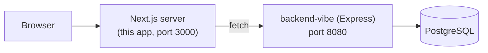
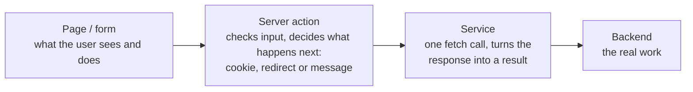
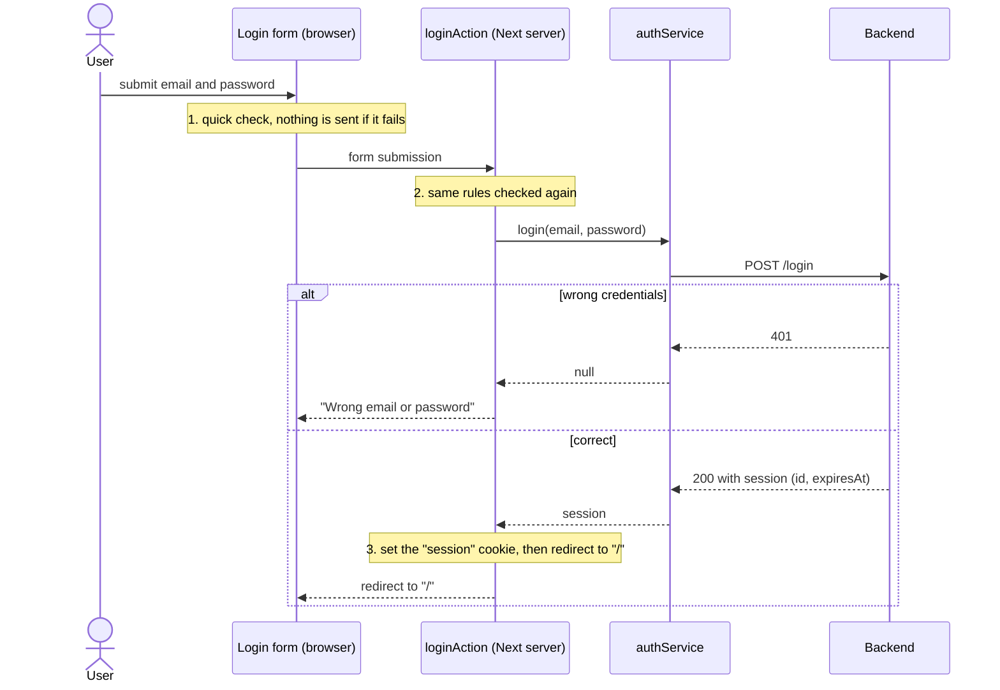
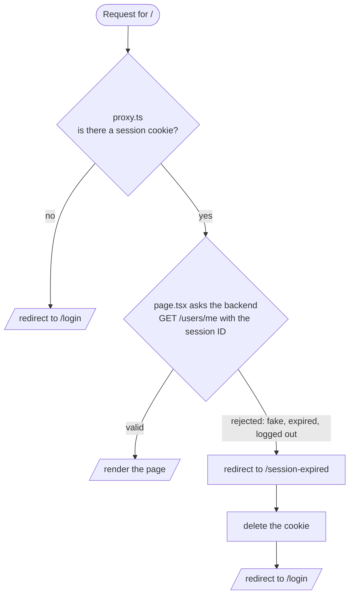

# Architecture

How the frontend is built. For the reasons behind each choice, follow the links
to the decision records in [decisions/](decisions/).

## The big picture

The browser talks only to the Next.js server. The Next.js server talks to the
backend. The browser never learns the backend's address, and it is never
trusted to say who the user is. See [0001](decisions/0001-backend-called-from-next-server.md).

## Where code runs

Next.js runs code in two places, and mixing them up is the most common source of
confusion:

| Code | Runs on | Examples here |
|---|---|---|
| Server components (default in `app/`) | Next.js server | `app/page.tsx`, `app/user/page.tsx` |
| Server actions (`"use server"`) | Next.js server, called from a form | `actions/auth/authActions.ts` |
| Services | Next.js server | `services/auth/authService.ts` |
| Client components (`"use client"`) | Browser | `LoginForm.tsx`, `SignupForm.tsx` |
| `proxy.ts` | Next.js server, before the page | the cookie check |

Because the `fetch` to the backend lives in services that are only called from
the server, `API_URL` never reaches the browser.

## The layers

- **Form (client component):** collects input, shows errors, and runs a quick
  check so the user gets instant feedback.
- **Server action:** the entry point on the server. Re-validates the input,
  calls a service, then decides the outcome: set the cookie, redirect, or return
  an error message for the form.
- **Service:** only talks to the backend. It turns an HTTP answer into a plain
  result. Example: login returns the session, or `null` for a 401. A backend that
  cannot be reached throws `ServiceUnavailableError`.

## How login works

The cookie is set with:

- `httpOnly`: the browser's JavaScript cannot read it
- `sameSite: lax`
- `secure`: only in production (dev runs on https anyway)
- `expires`: the same time the backend gave

The cookie holds only the random session ID. The user's data stays in the
backend. See [0001](decisions/0001-backend-called-from-next-server.md).

The form data goes to the server action as a form submission, and the response
is not JSON either (React uses its own format). Only the Next-server-to-backend
call is plain JSON.

## How a protected page stays protected

Two checks, doing different jobs:

- `proxy.ts` is only a **fast, optimistic** check. A fake cookie passes it.
- The **real** check is the backend call. The backend decides.
- `/session-expired` exists because pages cannot delete cookies, but route
  handlers can. Without deleting the bad cookie, `proxy.ts` would see a cookie,
  send the user back to `/`, the backend would reject it again, and it would loop
  forever.

See [0002](decisions/0002-optimistic-proxy-real-check-in-backend.md).

## Errors: what the user finally sees

| What went wrong | Service result | What the action does | What the user sees |
|---|---|---|---|
| Wrong email or password | `null` | returns a message | "Wrong email or password" on the form |
| Signup email taken, or validation | `{ success: false, errors }` | returns the field errors | Messages under the fields |
| Backend not reachable | throws `ServiceUnavailableError` | catches it, returns a message | "Service unavailable, try again later." |
| Any other failure | throws `Error` | catches it, returns a message | "Something went wrong. Please try again." |
| Session rejected on a page | `getMe` returns `null` | page redirects | Back at `/login` |
| Logout when the session is already gone (401) | treated as success | cookie deleted anyway | `/login` |

Expected outcomes are return values. Unexpected ones are thrown and caught in the
action.

## Validation lives in two places

`lib/validation/` holds the rules (valid email, password of 8+ characters). The
form uses them for instant feedback and the server action uses them again,
because anything coming from the browser can be bypassed. The backend checks a
third time and is the final authority. The rules are written in both repos, so
they can drift. See [0003](decisions/0003-validate-on-client-and-server.md).

## Testing

Vitest runs in Node (no browser). The one test is an integration test of
`authService.login` against the real backend. See [0004](decisions/0004-vitest-integration-test.md).
